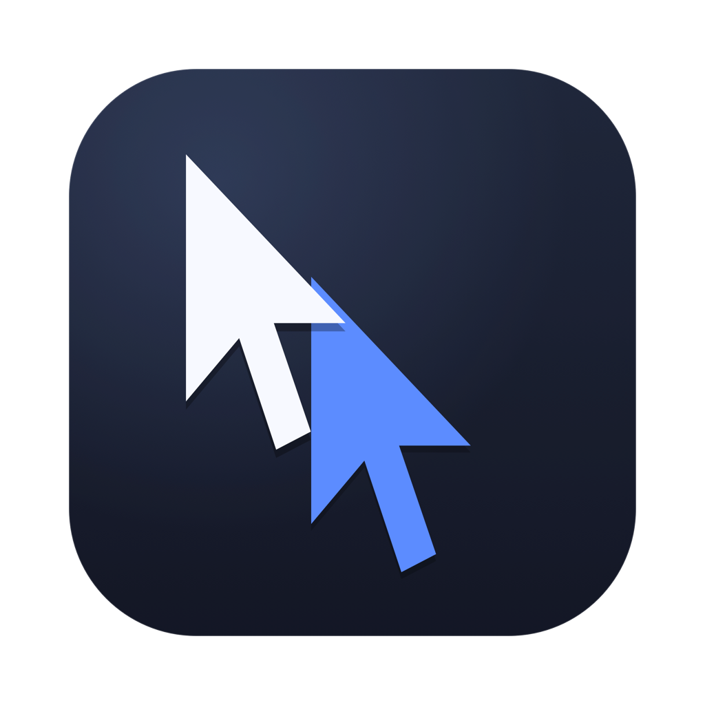
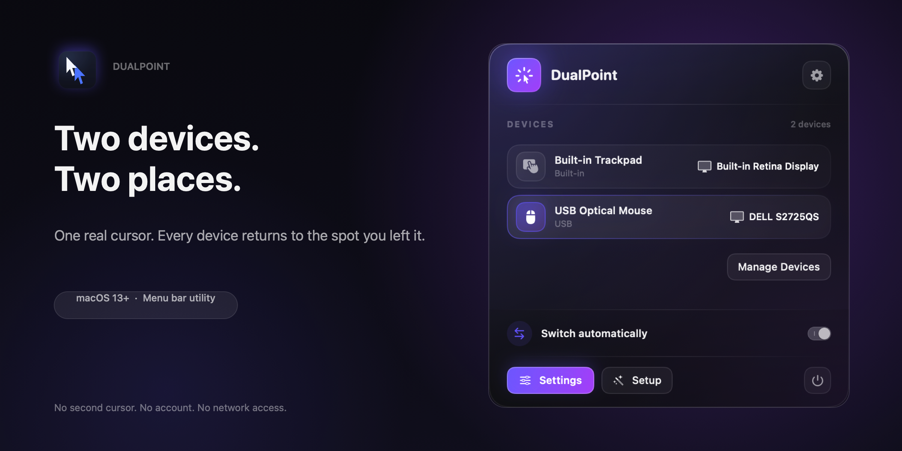
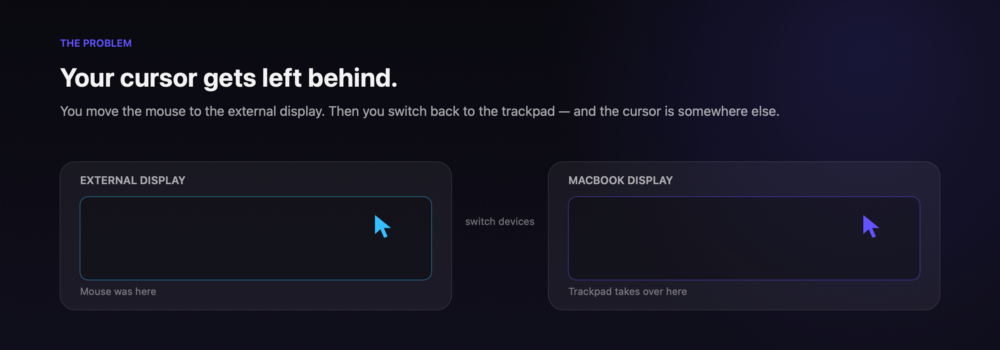
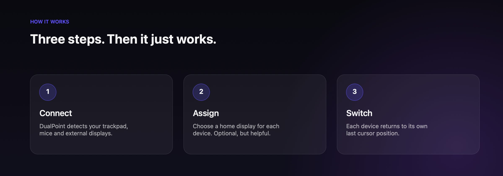
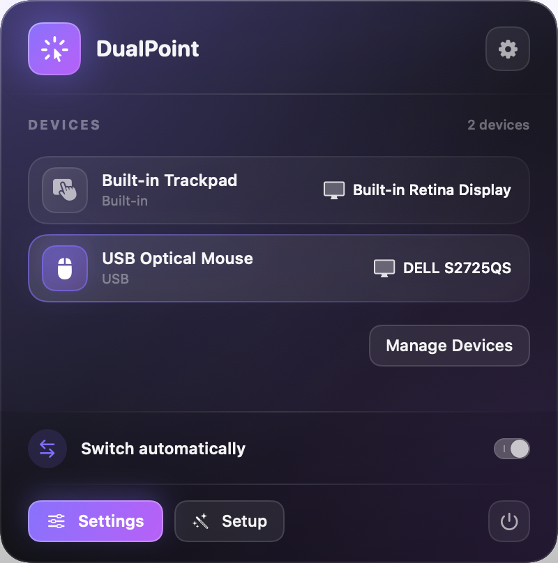
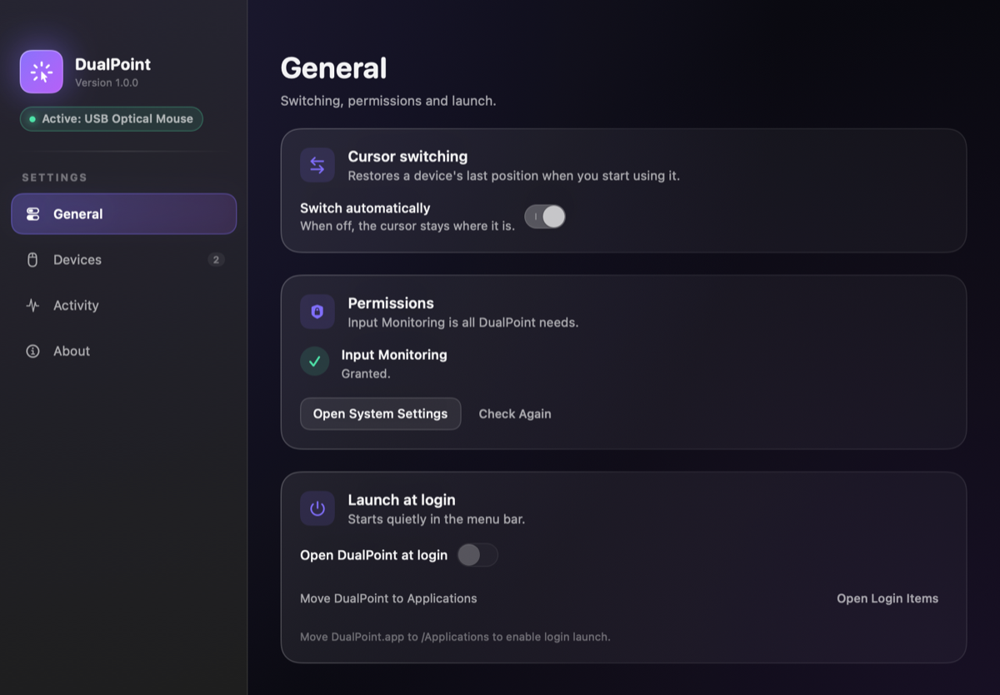
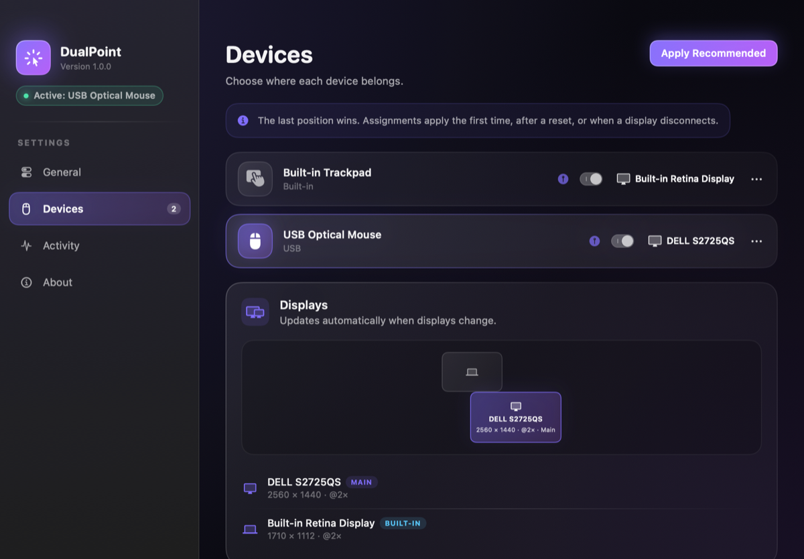
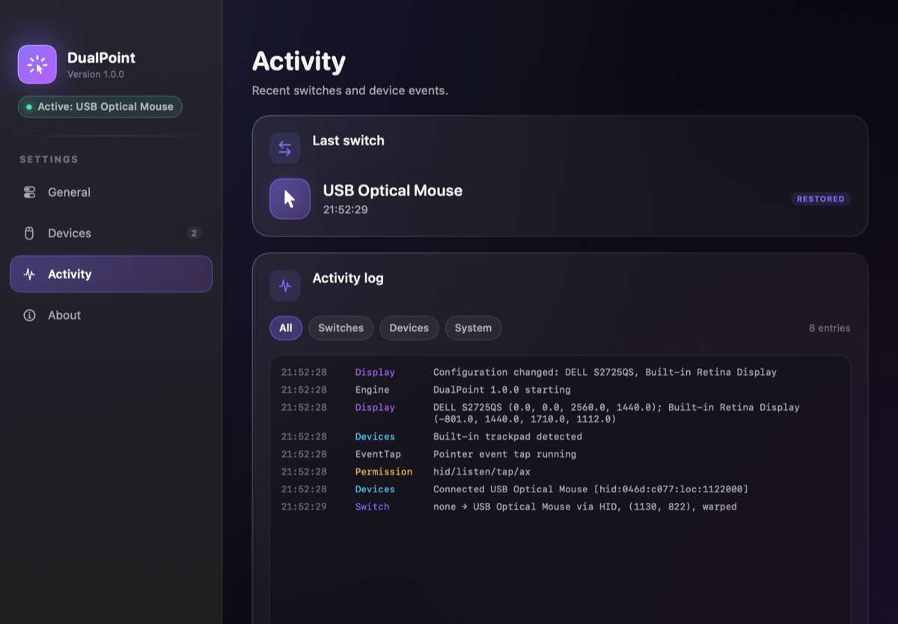
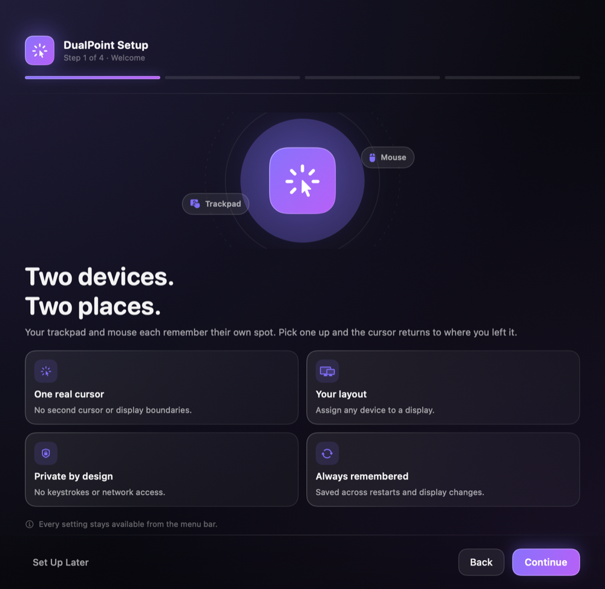
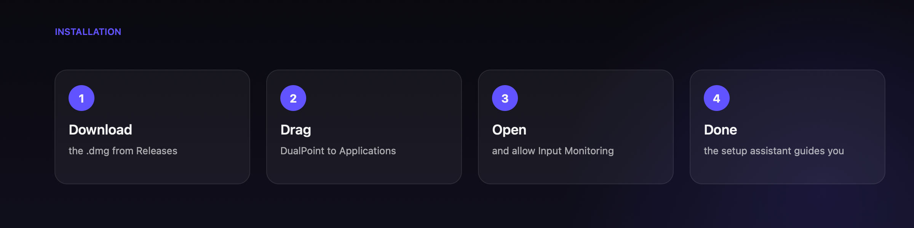

<div align="center">



# DualPoint

**Your cursor. Your devices. Their own place.**




</div>

DualPoint is a small macOS menu bar app. It remembers where your trackpad and your mouse each left the cursor, and brings the cursor back to that spot when you switch devices.

One real cursor. No second pointer. No changes to the way macOS normally behaves.

---

## The problem

You move your mouse over to the external display. Then you reach for the trackpad — and the cursor is still over on the other screen. Every switch means a little hunt for the pointer.

<div align="center">

</div>

DualPoint remembers a separate position for every pointing device. Pick one up and the cursor returns to where you left it.

## How DualPoint works

<div align="center">

</div>

1. **Connect your pointing devices.** DualPoint detects the built-in trackpad, mice, external trackpads and devices you plug in later.
2. **Assign each device to a display.** This gives every device a starting point. Once you actually use a device, its last real position wins.
3. **Switch devices.** The cursor goes back to that device's own saved spot. Drag and drop, gestures and normal movement across displays keep working.

## Features

- **Individual cursor positions** — your trackpad and each mouse keep their own last position.
- **Automatic device switching** — movement or a click on another device activates it.
- **Display-specific memory** — positions are saved relative to a display, so resolution and arrangement changes do not lose them.
- **External display support** — assign devices to the built-in screen or any connected display, or leave them unmanaged.
- **Device recognition** — devices are identified stably, and saved settings migrate when a USB device moves to another port.
- **Menus where you need them** — a quiet menu bar panel, full Settings, and a four-step setup assistant with a test drive.
- **Local by design** — all data stays in two plain files on your Mac.

## Screenshots

<p align="center">
  
  
</p>

<p align="center">
  
  
</p>

<p align="center">
  
</p>

<sub>Screenshots come from the real app rendered offscreen on macOS 27.2 with an Apple M3 and a Logitech USB mouse.</sub>

## Privacy

DualPoint works entirely on your Mac.

- Your data stays on your device. No account, no sign-in.
- No network connections of any kind.
- No keystroke recording.
- No movement history.
- No screen, window or application monitoring.

It reads only device metadata, pointer activity timestamps and display information. The two local files are:

```text
~/Library/Application Support/DualPoint/state.json
~/Library/Logs/DualPoint/DualPoint.log
```

You can delete them at any time. See [Permissions & privacy](docs/PERMISSIONS.md) for the full explanation.

## Installation

<div align="center">

</div>

1. Download the latest **DualPoint-1.0.0.dmg** from the [Releases page](https://github.com/Pablomatisch/DualPoint/releases).
2. Open the downloaded disk image.
3. Drag **DualPoint** into your **Applications** folder.
4. Open DualPoint from Applications.
5. Follow the setup assistant.
6. Allow **Input Monitoring** when macOS asks for it.

You can also download the `.zip`, unzip it, and move `DualPoint.app` to Applications.

### Where to grant Input Monitoring

If macOS does not show the permission prompt automatically, open:

```text
System Settings → Privacy & Security → Input Monitoring
```

Turn DualPoint on, then click **Check Again** in DualPoint's Settings or setup assistant. No restart is needed.

### If macOS blocks the app

This first release is ad-hoc signed and not notarized. Gatekeeper may show *"DualPoint cannot be opened because the developer cannot be verified."* If that happens, control-click **DualPoint** in Applications, choose **Open**, and confirm **Open** once. After that it launches normally.

### Quit and uninstall

Quit DualPoint from the menu bar panel. To remove it, delete `DualPoint.app` from Applications. Optionally delete the two files listed under [Privacy](#privacy).

## Requirements and compatibility

**Requirements**

- macOS 13 Ventura or later
- Apple Silicon (arm64)
- Input Monitoring permission

**Verified environment**

- Apple M3, macOS 27.2
- Built-in Retina display and DELL S2725QS external display
- Built-in trackpad and Logitech USB Optical Mouse (`046D:C077`)

Other hardware combinations have not been verified yet. See [TESTING.md](docs/TESTING.md) for the exact status.

## FAQ

**Does DualPoint create a second cursor?**
No. There is exactly one real macOS cursor. DualPoint moves it, it does not draw another one.

**Does it change normal macOS cursor behaviour?**
No. Pointer acceleration, drag and drop, gestures, scrolling and movement across display boundaries are untouched.

**Does it work with external displays?**
Yes. You can assign a device to any connected display, and saved positions follow the display when its arrangement changes.

**Why does DualPoint need Input Monitoring?**
macOS does not label pointer events with the device that produced them. DualPoint needs Input Monitoring to read HID device reports and observe pointer events locally so it can tell a mouse movement from a trackpad movement.

**Does it collect personal data?**
No. No account, no network, no keystrokes, no movement history, no screen or window contents.

**Why does macOS sometimes ask for permissions again?**
Permissions are tied to the app signature. Rebuilding the app from source creates a new identity, so Input Monitoring can need to be granted again. The released app keeps the same signature until a new release is installed.

**Can I turn switching off?**
Yes. Turn off *Switch automatically* in the menu bar panel or in Settings. Positions are still recorded; the cursor simply does not jump.

## Known limitations

- On Apple Silicon, the built-in trackpad does not emit classic HID reports. Its activity is inferred from pointer events that cannot be matched to another device.
- Moving a USB device to a different port changes its location ID. Settings are migrated when exactly one previous device matches; two identical devices disconnected at the same time cannot be told apart until they are used again.
- DualPoint does not work at the login window or while the Mac is locked.
- Automatic switching pauses while permissions or setup are incomplete.
- This first release is ad-hoc signed and not notarized, so Gatekeeper steps may be required on first launch.

Technical details and the full hardware checklist live in [docs/ARCHITECTURE.md](docs/ARCHITECTURE.md), [docs/PERMISSIONS.md](docs/PERMISSIONS.md), [docs/DESIGN.md](docs/DESIGN.md) and [docs/TESTING.md](docs/TESTING.md).

## Support and feedback

Found a bug, a device that is not detected, or an unexpected cursor jump? Please open an issue and include your macOS version, Mac model, pointing devices and, if possible, the last lines of `~/Library/Logs/DualPoint/DualPoint.log`.

- [Report an issue](https://github.com/Pablomatisch/DualPoint/issues)
- [All releases](https://github.com/Pablomatisch/DualPoint/releases)

## License

DualPoint is released under the [MIT License](LICENSE). It applies to the original source code, documentation and generated artwork in this repository. DualPoint has no third-party source dependencies: it uses macOS system frameworks and fonts, which are not redistributed, and all icons and screenshots are generated by this project.

---

<div align="center">


**DualPoint — one cursor, every device its own place.**

[Issues](https://github.com/Pablomatisch/DualPoint/issues) · [Releases](https://github.com/Pablomatisch/DualPoint/releases) · [Architecture](docs/ARCHITECTURE.md) · [Permissions](docs/PERMISSIONS.md)

Copyright © 2026 DualPoint. All rights reserved.

</div>
